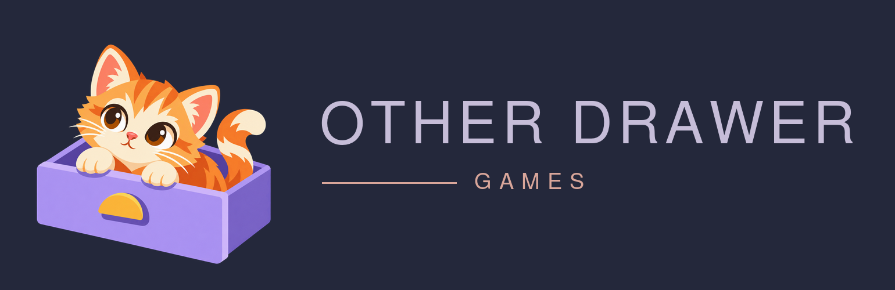

  

<h1 align="center">A little unexpected.</h1>

  <strong>Curious, characterful games. Thoughtfully made.</strong> 
  Small moments, memorable discoveries, and a soft spot for the unexpected.

---

### Hello from Other Drawer Games 👋

We're a small independent game studio in Australia. We love approachable experiences, comfortable pacing, playful details, and the pleasure of discovering something you almost missed.

We believe a little game can still have a lot of heart.

### What we're making

| Game | A little about it | Status |
| --- | --- | --- |
| **Last Night** | A cosy, illustrated clean-up game about restoring a house after a party — and discovering the stories left behind. | In development |
| **A Little Secret** | A simple, friendly way to organise a Secret Santa and keep the surprise alive. | In development |

### How we think about games

- **Reward curiosity.** Make space for surprises and tiny discoveries.
- **Respect your time.** Play at your own pace, without pressure to keep coming back.
- **Care about the craft.** Make the little interactions feel just right.
- **Keep things welcoming.** No artificial urgency, manipulative hooks, or adverts.
- **Offer fair value.** Complete games at fair prices, with optional extras only when they add something genuinely worthwhile.

**Make a good game. Charge a fair price. Let people enjoy it.**

---

<em>There's always something in the other drawer.</em>

